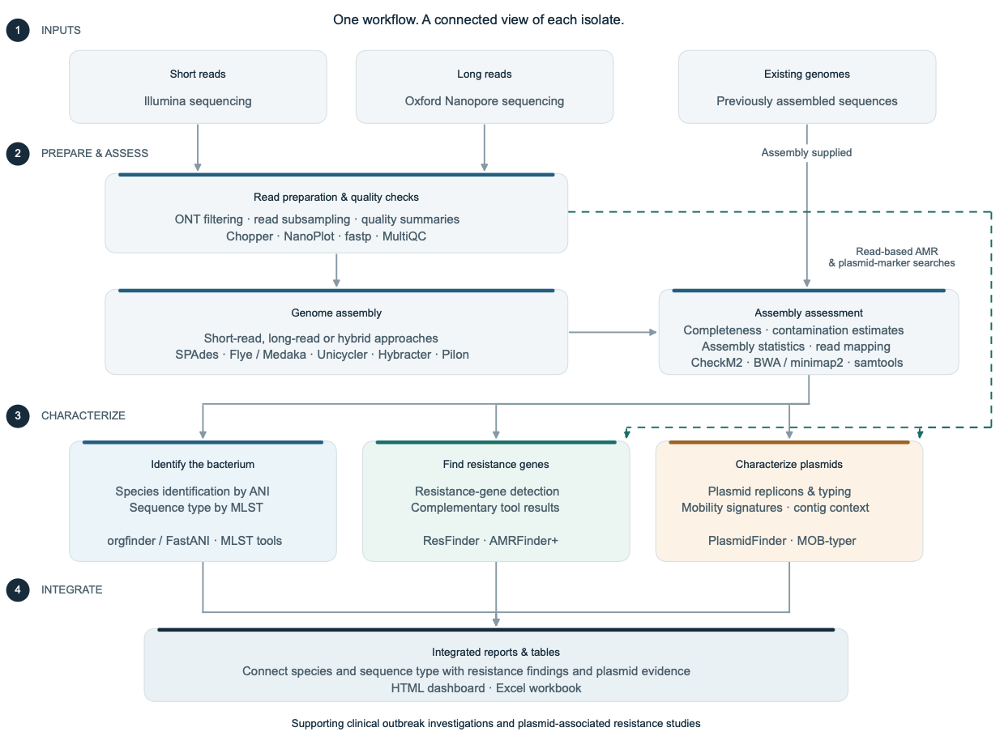

# amr-tools

`amr-tools` is a nextflow pipeline to process sequencing data of Antimicrobial Multi-Resistance bacteria with
a focus on plasmids. It is actively developed by [Diego Andrey Lab](https://www.unige.ch/medecine/demed/en/research/andrey-diego)
at the University of Geneva and Geneva University Hospital.


|  |
|:--:|
| **Figure 1:** *Overview of `amr-tools` pipeline* |

The pipeline runs: reads filtering → reads QC → de novo assembly → assembly QC → AMR annotation.
Each step is also available as a standalone pipeline (see [Standalone pipelines](#standalone-pipelines)).


# Installation

`amr-tools` depends on nextflow (>= 26.10.4), that can be installed with: 

```bash
curl -s https://get.nextflow.io | bash
```

Test `amr-tools` installation (runs the pipeline on 4 plasmids downloaded from ENA, and on ONT reads of *Klebsiella pneumoniae* downloaded from ENA, [ERR14747186](https://www.ebi.ac.uk/ena/browser/view/ERR14747186), 332 MB, that are assembled):

```bash
nextflow run pradosj/amr-tools -profile standard,test
```

# Usage

## Local computer

Running the pipeline on a local computer requires [`docker`](https://www.docker.com) 
(to run containerized software) and [`nextflow`](https://www.nextflow.io).

If the FASTA files to process are in subfolder 'assemblies/' of your working directory

```bash
nextflow run pradosj/amr-tools --assemblies.fasta='assemblies/*.fasta'
```

File inputs (`--reads.ont`, `--reads.illumina`, `--assemblies.fasta`, and `--query`/`--fasta` in the standalone pipelines) are
comma-separated lists of paths, glob patterns and URLs (a URL names one file: no glob pattern in URLs), e.g.
`--assemblies.fasta='assemblies/*.fasta,https://www.ebi.ac.uk/ena/browser/api/fasta/CP047704.1'` or
`--reads.illumina='https://ftp.sra.ebi.ac.uk/vol1/fastq/<run path>/<run>_1.fastq.gz,https://ftp.sra.ebi.ac.uk/vol1/fastq/<run path>/<run>_2.fastq.gz'`.
The sample id is the file name without its extension (and without the `_R1`/`_R2` suffix of paired-end Illumina reads).
FASTA inputs can be gzipped (`.fasta.gz`, `.fa.gz`, `.fna.gz`): they are decompressed.

To assemble and annotate reads (the sample id is taken from the file names):

```bash
nextflow run pradosj/amr-tools --reads.ont='ont/*.fastq.gz' --reads.illumina='illumina/*_R{1,2}.fastq.gz' --assembler.name=hybrid_unicycler
```

Inputs can also be given with a samplesheet: `--csv samples.csv` (columns `sample_id`, `reads_long`, `reads_short_1`, `reads_short_2`, `assembly_fasta`, `assembly_info`).
ONT reads can be given as FASTQ, BAM or CRAM files.

Main options:

 - `--assembler.name`: assembly strategy, one of `long_flye`, `long_flye_medaka` (default), `long_unicycler`, `long_hybracter`, `short_unicycler`, `short_spades`, `hybrid_unicycler`, `hybrid_hybracter`, `hybrid_flye_medaka_pilon`
 - `--no_reads_filter`: assemble the given reads, without filtering them
 - `--no_reads_qc`: skip the reads QC report
 - `--amr.<tool>.skip` and `--amr.<tool>.args`: disable or configure an AMR annotation tool
 - `--db.basedir`: databases folder (default `results/db`, built when missing) or archive, see [Databases](#databases)
 - `--verbose`: also publish the assembler output folders

See `nextflow_schema.json` for all the options.

## Databases

The pipeline uses three databases: CheckM2, the orgfinder reference genomes (built from NCBI, the longest) and AMRFinderPlus.
They are read from the databases folder `--db.basedir` (default `results/db`), each in its sub-folder `--db.checkm2`,
`--db.org_db`, `--db.amrfinderplus` (paths relative to `basedir`, default `checkm2`, `org_db`, `amrfinderplus`).
A database missing from the folder is built and saved to `<output dir>/db/`: with the default options, the first run
fills `results/db` and the next runs reuse it.

```bash
# build all the databases once (results/db/), with a tar archive of them (results/amr-tools-db.tar.gz)
nextflow run pradosj/amr-tools/wf/db

# use a databases folder, or a tar archive of it given as a path or an URL
nextflow run pradosj/amr-tools --db.basedir=/data/amr-tools/db --reads.ont='ont/*.fastq.gz'
nextflow run pradosj/amr-tools --db.basedir=https://example.org/amr-tools-db.tar.gz --reads.ont='ont/*.fastq.gz'

# use another version of a database of the folder
nextflow run pradosj/amr-tools --db.basedir=/data/amr-tools/db --db.amrfinderplus=amrfinderplus_2026-01 --reads.ont='ont/*.fastq.gz'
```

An archive is extracted once (cached by `-resume`) and must hold all the needed databases. The databases of the folder
are used as is: to update a database, delete its folder (or give another `--db.<name>`) to build it again.

## HPC

To run the pipeline on a HPC cluster with `slurm` and `apptainer` use `-profile hpc`:

```bash
nextflow run pradosj/amr-tools -profile hpc --reads.ont='ont/*.fastq.gz'
```

Other profiles: `docker` (same as the default `standard`), `arm64` (arm64 images), `tiny` (low resource limits).


## Pipeline outputs

By default, pipeline outputs are stored in `results/` but it can controlled with 
option `-output-dir`.

The output folder `results` has the following organization:

 - `results/reports`: Folder containing final reports, with QC metrics and annotations

 - `results/db`: databases built by the run (`checkm2/`, `org_db/`, `amrfinderplus/`), found by the next runs with the default `--db.basedir`
 
 - `results/assemblies`: FASTA of assembled genomes, and CheckM2 results

 - `results/reads`: filtered reads

 - `results/amr`: results of the AMR annotation tools, by assembly (`amr/assemblies/`) and by reads sample (`amr/reads/`)


# Standalone pipelines

Each step of `amr-tools`, and a few other tools, can be run on its own from the `wf/` folder,
e.g. `nextflow run pradosj/amr-tools/wf/amr-annot --assemblies.fasta='assemblies/*.fasta'`.

| Pipeline | Description |
|:--|:--|
| [`reads-qc`](wf/reads-qc) | Quality control of ONT and Illumina reads (NanoPlot, fastp, MultiQC) |
| [`reads-filter`](wf/reads-filter) | Filtering and subsampling of the reads |
| [`assemble`](wf/assemble) | De novo assembly from ONT and/or Illumina reads |
| [`assemblies-qc`](wf/assemblies-qc) | Quality control of assemblies (statistics, reads alignments, CheckM2) |
| [`amr-annot`](wf/amr-annot) | AMR and plasmid annotation of assemblies and reads, with a multi-sample report |
| [`orgfinder`](wf/orgfinder) | Organism detection of assemblies with FastANI |
| [`plasmid-lineage`](wf/plasmid-lineage) | Lineage of a set of plasmids: rotation, alignment, AMR annotation, HTML report |
| [`asm-compare`](wf/asm-compare) | Comparison of assemblies with a reference assembly |
| [`gtf2gff`](wf/gtf2gff) | Conversion of a NCBI GTF into a GFF for `bcftools csq` |
| [`db`](wf/db) | Build the databases of the pipelines (CheckM2, orgfinder, AMRFinderPlus) and a tar archive of them |

See the README of each pipeline for its options.
